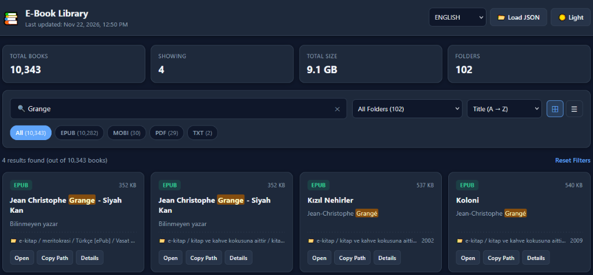
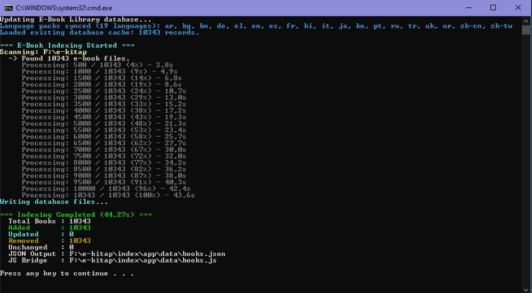

# Local E-Book Library Indexer & Web Search

Index thousands of e-books spread across multiple local folders into a single JSON (and optional XML) database using a zero-dependency script (**Windows, macOS & Linux**), then search and browse them instantaneously through an offline HTML/CSS/JavaScript web interface.

No web server, database engine, folder configuration, or internet connection required.

## Screenshots

### Offline Web Interface


### Indexer Console (`update-index.bat` / `update-index.sh`)


## Features

- **Cross-platform (Windows, macOS & Linux)**:
  - **Windows:** Uses built-in PowerShell (`update-index.bat` → `app/scripts/index-ebooks.ps1`) with zero extra software.
  - **Linux & macOS:** Uses standard Python 3 (`update-index.sh` → `app/scripts/index-ebooks.py`) with zero external packages (`pip` not required).
- **Zero-configuration automatic scanning**: Place this folder inside your main e-books directory and run the updater — it automatically scans every sibling folder at the same level as well as books inside this folder itself (while excluding `app/`, `.github/`, `.git/`, and `.gitignore`).
- **Incremental updates**: Unchanged files reuse cached metadata; only new, modified, or deleted books are processed.
- **Native EPUB metadata extraction**: Reads title, author, publisher, year, language, tags, and description directly from `.epub` archives without external tools.
- **Filename parsing fallback**: Extracts author, title, and year from filenames (e.g. `Author - Title (2020).pdf`) for PDF, MOBI, AZW3, DJVU, FB2, CBR/CBZ, TXT, DOCX, and RTF files.
- **Zero-server `file://` compatibility**: Automatically generates `app/data/books.js` and `app/lang/languages.js` bridges alongside the JSON files so double-clicking `index.html` works out of the box without browser CORS errors.
- **Fast offline web UI**: Instant multi-word diacritic-insensitive search, format filters, folder filters, sorting, Grid/List views, Light/Dark theme, book detail modal, and one-click path copying.
- **Multi-language UI (`app/lang/`)**: Ships with 19 built-in language packs (including RTL support for Arabic and Urdu) and automatically discovers any new `app/lang/*.json` file.

## Project Structure

```text
.
├── index.html                        # Main offline web interface
├── update-index.bat                  # Double-click updater for Windows (PowerShell)
├── update-index.sh                   # Updater for Linux & macOS (Python 3)
├── LICENSE                           # MIT License
├── .gitattributes                    # Cross-platform line-ending rules
├── .gitignore                        # Git ignore rules
├── .github/
│   ├── README.md                     # Documentation (rendered automatically on GitHub)
│   └── assets/                       # README screenshots
└── app/
    ├── assets/
    │   ├── app.js                    # Client-side search, filtering, and i18n logic
    │   └── styles.css                # Responsive light/dark theme stylesheet
    ├── config/
    │   └── config.json               # Supported extensions & excluded folder names
    ├── data/
    │   ├── books.json                # Generated UTF-8 JSON database (gitignored)
    │   └── books.js                  # Generated file:// database bridge (gitignored)
    ├── lang/
    │   ├── en.json                   # English language pack
    │   ├── tr.json                   # Turkish language pack
    │   ├── ...                       # 17 additional language packs
    │   ├── manifest.json             # Auto-generated language list
    │   └── languages.js              # Auto-generated file:// language bridge
    └── scripts/
        ├── index-ebooks.ps1          # Windows PowerShell indexer
        └── index-ebooks.py           # Cross-platform Python 3 indexer (Linux/macOS/Windows)
```

## Quick Start

1. **Place this folder inside your e-books directory**  
   For example, if your e-books are in `D:\E-Books\Sci-Fi` (Windows) or `~/E-Books/Sci-Fi` (Linux/macOS), place this project folder at `D:\E-Books\index` or `~/E-Books/index` (or `hurkals-local-ebook-library`).  
   The updater automatically scans the parent directory (all sibling folders + inside the project folder itself), skipping `app/`, `.github/`, `.git/`, and `.gitignore`.

2. **Build or update the database**
   - **Windows (easiest):** Double-click `update-index.bat`.
   - **Linux & macOS:**
     ```bash
     chmod +x update-index.sh
     ./update-index.sh
     ```
   - **Optional CLI flags:**
     - **Windows PowerShell:**
       ```powershell
       powershell -ExecutionPolicy Bypass -File .\app\scripts\index-ebooks.ps1 [-ExportXml] [-Force] [-Fast] [-OnlyLang] [-Folders "C:\Books","D:\PDF"]
       ```
     - **Linux / macOS (Python 3):**
       ```bash
       ./update-index.sh [--export-xml] [--force] [--fast] [--only-lang] [--folders ~/Books ~/PDF]
       ```

3. **Browse & search**  
   Open `index.html` directly in your browser. Whenever you add or remove books, run `update-index.bat` (Windows) or `./update-index.sh` (Linux/macOS) and refresh the page (`F5`).

## Contributing a Language Pack

1. Copy `app/lang/en.json` to `app/lang/<code>.json` (for example, `app/lang/nl.json`).
2. Update `code`, `name`, `locale` (and `"dir": "rtl"` for right-to-left languages), and translate the values inside `strings`.
3. Sync language packs:
   - Windows: `powershell -ExecutionPolicy Bypass -File .\app\scripts\index-ebooks.ps1 -OnlyLang`
   - Linux / macOS: `./update-index.sh --only-lang`
4. Open `index.html` — your new language will automatically appear in the language selector.
